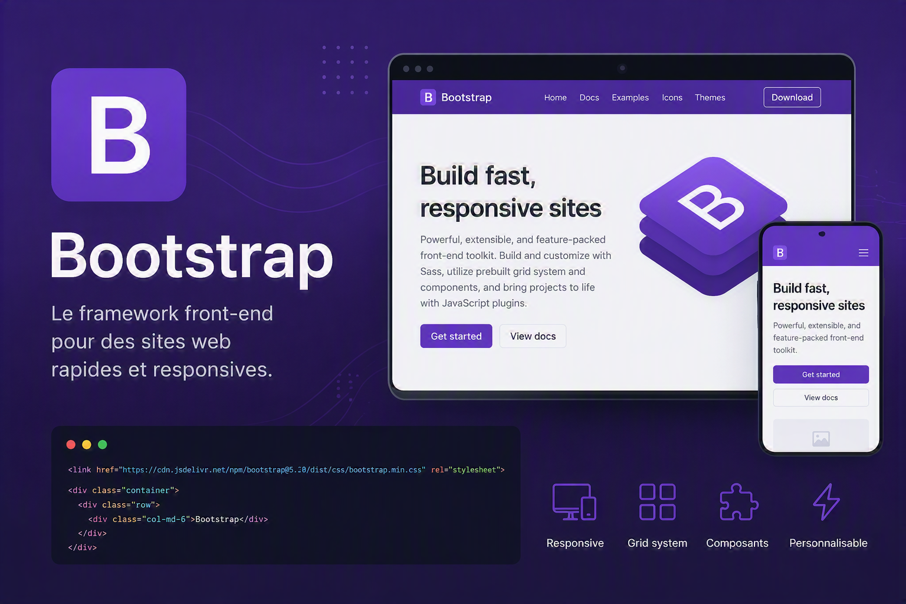

# Bootstrap

## Rôle de Bootstrap dans un site responsive

Bootstrap fournit des briques prêtes à l'emploi pour concevoir rapidement une interface cohérente et adaptable. L'idée centrale est de combiner :

- une **grille responsive** (breakpoints) qui organise la mise en page,
- des **composants** (boutons, alertes, cartes, formulaires) qui standardisent l'UI,
- des **utilitaires** de mise en forme (espacements, tailles, alignements) qui facilitent les ajustements.

Concrètement, Bootstrap permet de passer d'une maquette conceptuelle (contenu + structure) à une mise en page opérationnelle, tout en limitant les ruptures entre mobile, tablette et desktop. La logique est en général **mobile-first** : on définit d'abord une mise en page utilisable sur petits écrans, puis on l'enrichit à l'aide des breakpoints.


*Image générée par IA*

## Grille responsive (exemple)

```html
<div class="container">
  <div class="row">
    <div class="col-12 col-md-6">
      Bloc A
    </div>
    <div class="col-12 col-md-6">
      Bloc B
    </div>
  </div>
</div>
```

- `col-12` : sur mobile (petit écran), chaque bloc prend toute la largeur.
- `col-md-6` : à partir de `md`, on passe à deux colonnes.

## Breakpoints

Les breakpoints correspondent à des **seuils de largeur d'écran** utilisés par Bootstrap pour activer des variantes de style. L'objectif n'est pas de faire varier l'apparence au hasard, mais d'éviter que la mise en page ne devienne illisible ou inadaptée quand la largeur change.

- Sur mobile, la priorité va à une lecture linéaire : une colonne, des marges suffisantes, des éléments interactifs bien espacés.
- À mesure qu'on atteint des paliers (tablette → desktop), on peut progressivement réintroduire plusieurs colonnes, des zones latérales et une densité informationnelle mieux contrôlée.

Dans une démarche pédagogique, cette logique aide à conserver la même structure de contenu (même intention), tout en l'adaptant aux contraintes du support.

## Composants utiles pour l'apprentissage

- **Alerts** (points d'attention)
- **Cards** (fiches, notions)
- **Badges** (statuts, niveaux)
- **Tabs** (comparaisons)

### Exemple : alerte

```html
<div class="alert alert-info" role="alert">
  Rappel : testez toujours sur plusieurs tailles d'écran.
</div>
```

## Personnalisation et bonnes pratiques

Même si Bootstrap fournit une base solide, l'enjeu pédagogique reste la qualité de la lecture. La personnalisation sert à harmoniser l'interface avec le contenu, éviter les débordements, et renforcer l'accessibilité.

Bonnes pratiques :

- **Garder une hiérarchie visuelle** : utiliser des titres et composants de manière cohérente (mêmes styles pour des rôles similaires).
- **Préserver la lisibilité mobile** : privilégier des tailles adaptées et des espacements suffisants entre blocs.
- **Limiter la surcharge** : un composant (cards, alerts, tabs) doit aider à comprendre, pas seulement décorer.
- **Vérifier l'accessibilité** : contraste, taille des zones cliquables, navigation clavier (si pertinent).

## Points d'attention (pédagogie et accessibilité)

- Ne pas confondre « responsive » et « lisible » : vérifier la typographie (taille, interlignage, longueur des lignes).
- Éviter que les tableaux deviennent illisibles sur mobile : préférer une alternative (cartes, affichage en blocs) ou une version adaptée.
- Limiter les interfaces trop denses : préférer des regroupements et des espacements.