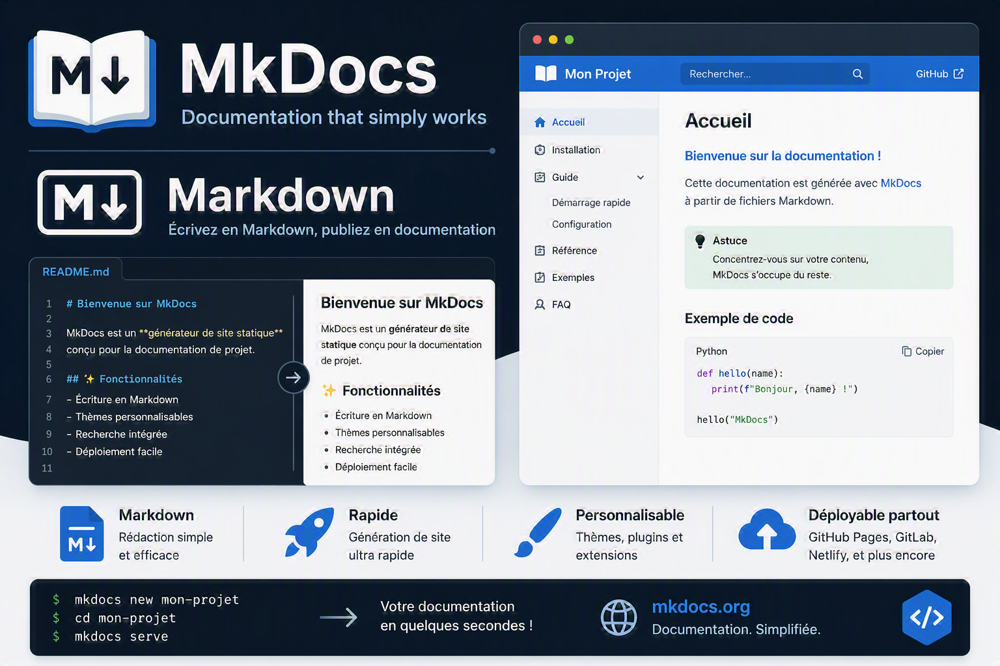

# MkDocs Material et responsive design

## Pourquoi MkDocs Material ?

MkDocs Material rend la publication plus simple :

- navigation structurée
- thèmes clair/sombre
- rendu Markdown enrichi
- éléments d'interface utiles pour la lecture (table des matières, copie de blocs de code, etc.)

Le responsive y est géré en grande partie par le thème. Cependant, l'ingénieur pédagogique doit tout de même produire un contenu lisible, structuré, et adapté à une lecture sur différents supports.



## Navigation et organisation

- Le fichier `mkdocs.yml` définit le menu via la section `nav`.
- Il déclare aussi le thème, la langue et les réglages de rendu.
- La structure des dossiers et pages Markdown doit correspondre aux chemins déclarés dans `nav`.

## Fonctionnement : du Markdown au site statique

MkDocs fonctionne comme un générateur : il lit les fichiers Markdown du dossier `docs/`, les convertit en pages HTML, puis les assemble avec les gabarits du thème Material. La configuration dans `mkdocs.yml` (thème, extensions et plugins) influence directement :

- l'organisation et l'apparence globale (thème Material),
- le rendu des contenus Markdown (extensions et syntaxe enrichie),
- la génération d'éléments d'interface utiles à la lecture (table des matières, blocs de code, recherche).

On obtient ainsi un site statique (sans serveur côté utilisateur), ce qui simplifie le déploiement et améliore la maintenabilité des ressources pédagogiques.

## Code et exemples dans Markdown

Avec les extensions Material/Pymdown, il est possible d'intégrer des blocs de code mis en forme et des composants interactifs directement dans les fichiers Markdown.

### Exemple : bloc de code

```html
<p>Exemple HTML</p>
```

### Exemple : onglets (si activés)

Les onglets permettent de présenter plusieurs versions d'un même contenu, par exemple pour comparer un rendu mobile et un rendu desktop :

```markdown
=== "Vue mobile"
    ... contenu ...

=== "Vue desktop"
    ... contenu ...
```

## Bonnes pratiques de contenu pour rester responsive

- Utiliser des titres clairs (pour la table des matières).
- Éviter les paragraphes trop longs : découper en sections.
- Regrouper les consignes et clarifier les étapes.
- Préférer des tableaux légers, ou ajouter une alternative si nécessaire.

L'objectif n'est pas seulement esthétique : il s'agit de garantir une expérience de lecture stable sur des contextes variés.